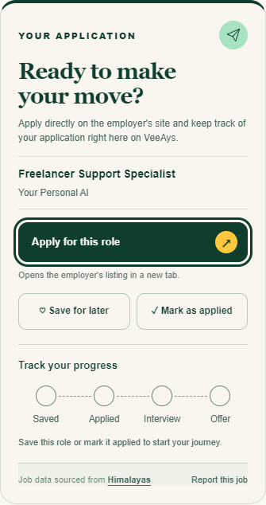
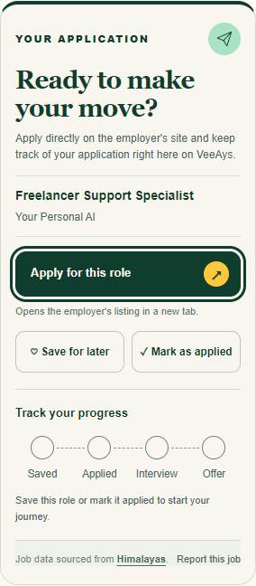

# Application sidebar redesign

Based on PR #10 merge cb1262e9daa18a9139bbf25624cfd56ae2fc12e4, targeting codex/recovered-production-auth-081b6577 (the branch into which #10 was merged).

Cream/deep-green panel with a restrained decorative paper plane, primary Apply action, side-by-side secondary actions, existing progress and a quiet attribution/report footer. Uses #0F3D2E, #22B07D, #A7E3C1, #FFC83D and #F8F6EE; coral is reserved rather than added as extra decoration. Follows the user’s written approved design; the referenced chat did not expose its mockup image.

Only detail markup and scoped CSS change application behavior presentation. Routes, form names/values, signup intent, save/unsave, applied/status logic, attribution, reports flag and acknowledgement are preserved. Free/Pro access and backend code are unchanged. No merge or deployment performed.

## Validation

- 23 focused tests passed: job-application-panel, job-final-polish, job-detail-header and home-save.
- Build: Wrangler deploy --dry-run passed (local log path). No deployment.
- git diff --check passed.
- Chrome local fixtures rendered using the actual detail renderer and repository stylesheet at 320, 390, 768 and 1280px: no horizontal overflow; secondary buttons share a row; visible keyboard focus; Tab follows Apply → Save → Mark applied → source → Report.
- Space on Save and Enter on Mark applied fire native submissions with original actions, job_id and return_to, intercepted locally to avoid mutations. Browser results: [browser-checks.json](application-sidebar/browser-checks.json).
- Long title/company fixtures and saved, applied, interview, offer, hired, rejected, withdrawn and anonymous states checked for overflow at desktop width; semantic state assertions cover every outcome.
- These are synthetic local fixtures, not authenticated production checks. Existing auth gates are covered by focused tests.

## Screenshots

[Desktop page](application-sidebar/page-1280.png) · [Mobile page](application-sidebar/page-390.png)

