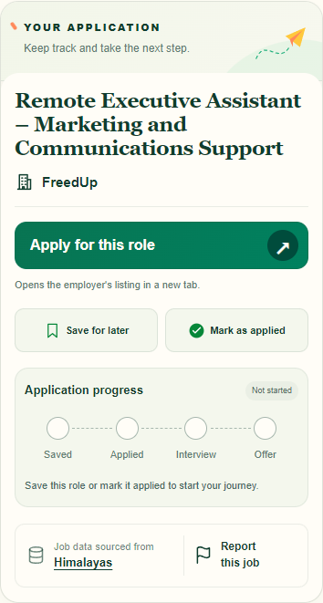

# Application sidebar — supplied mockup revision

PR #11 is based on PR #10 merge cb1262e9daa18a9139bbf25624cfd56ae2fc12e4, targeting codex/recovered-production-auth-081b6577.

The supplied **VeeAys Job Application Sidebar.png** is the primary visual reference. This revision replaces the previous callout headline with the job title as the main serif heading and follows the reference’s layered cream cards, compact green-tinted header, yellow/orange paper plane, green Apply button with dark arrow disc, icon-led secondary buttons, inset progress card/status badge, and bordered source/report footer. Decorative artwork stays within the header rather than adding height. The existing official logo is untouched.

The screenshot fixture uses the reference’s title and company for comparison. The sidebar adapts to the existing 335px desktop column and mobile widths, rather than reproducing the reference image’s 800px-wide presentation literally. Saved circles reflect actual saved state; an unsaved role is not displayed as saved merely to imitate the image. Hired and closed outcomes retain their existing semantics.

Only detail markup and scoped CSS change presentation. Routes, form names/values, signup intent, save/unsave, applied/status logic, attribution, reports flag and acknowledgement are preserved. Free/Pro access and backend code are unchanged. No merge or deployment performed.

## Validation

- 24 focused tests passed: job-application-panel, job-final-polish, job-detail-header and home-save.
- Wrangler dry-run build and git diff --check passed. No deployment.
- Chrome local fixtures use the actual detail renderer and repository stylesheet at 320, 390, 768 and 1280px: no horizontal overflow; secondary buttons share a row; visible keyboard focus; Tab follows Apply → Save → Mark applied → source → Report.
- Space on Save and Enter on Mark applied fire native submissions with original actions, job_id and return_to, intercepted locally to avoid mutations. Results: [browser-checks.json](application-sidebar/browser-checks.json).
- Long title/company fixtures and saved, applied, interview, offer, hired, rejected, withdrawn and anonymous states checked for overflow at all four widths. Semantic tests cover all application outcomes and the status badge.
- Synthetic local fixtures, not authenticated production checks. Existing auth gates are covered by focused tests. Whole-page images show the local job-detail fixture without site navigation.

## Updated screenshots

[Desktop page fixture](application-sidebar/page-1280.png) · [Mobile page fixture](application-sidebar/page-390.png)

Desktop sidebar (1280px viewport):

Mobile sidebar (390px viewport):

[Narrow 320px panel](application-sidebar/panel-320.png) · [768px panel](application-sidebar/panel-768.png)
