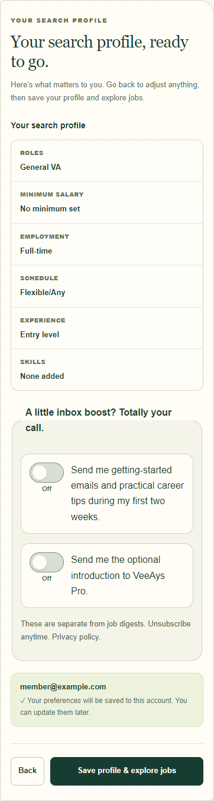
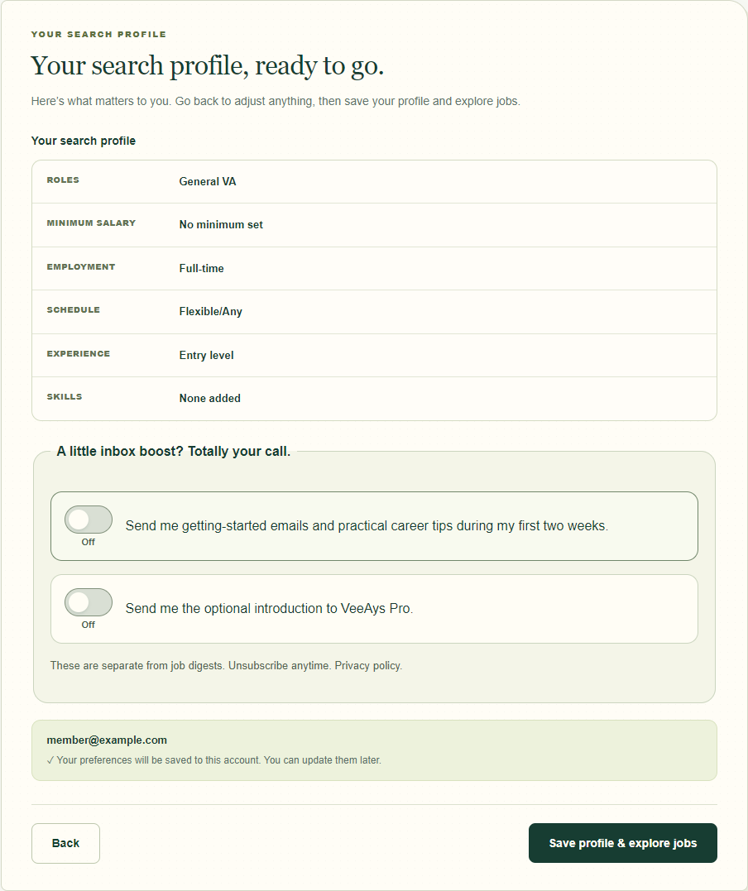
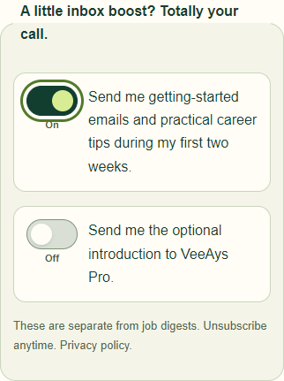
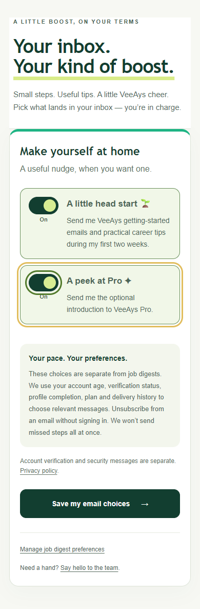

# Preference switch UI polish

Based on `codex/recovered-production-auth-081b6577` (draft PR #6), because main does not contain the two Review-step optional email consents. This PR changes only rendered controls, scoped styles, stylesheet cache version, tests and evidence. It does not reconcile production or change handlers, persistence, consent rules, flags, emails or configuration.

Converted independent binary choices:
- Search-profile Review: optional getting-started/career tips and Pro introduction.
- Member email choices: the same two preferences.
- My Job Alerts: include unknown salary and personalized digest opt-in.

Existing Email preferences native switches and admin notification sound switch remain intact. Roles, schedules, employment types and job-category multi-select checkboxes stay checkboxes. No legal-agreement or bulk-selection controls were changed.

The new visuals follow the existing forest-green/lime/cream Email preferences style. Controls retain native checkbox submission behavior with switch semantics, wrapping visible labels, a full-row target, keyboard Space/Tab support, visible focus, text On/Off indicators, reduced-motion support and forced-colors styles. Consent labels, unchecked opt-in defaults, existing saved states, field names/values and unsubscribe/privacy copy are unchanged. Saving still requires the existing form submit action.

Validation (18 October 2026):
- 27 focused tests passed: preference-switches, onboarding, job-alerts, email-preferences and auth-session-recovery.
- `npm run build` passed (Wrangler dry run only); `git diff --check` passed.
- Headless Chrome with actual rendered form markup, repository CSS and onboarding JavaScript: Space and Tab, focus ring, label clicks, absent unchecked form values versus `yes` when checked, and switch accessible names passed. Review tested at 320/390/1280px with no horizontal overflow. Member-email and alert forms also checked at 390px.
- Screenshots are local fixtures with synthetic member data, not authenticated production captures. Reduced motion was enabled to capture settled states. Review images show the two consents off; the focus image shows tips on after Space.

Release preparation after user approval: downloaded the current live Worker and existing 84 assets read-only. Repeated browser checks with the current compiled rendering functions and live CSS, including the member-email stylesheet absent from the recovered Git base. Added specificity for the shared control and state text so the existing member-email rules cannot override them. The full member-email preview now passes at 390px. The deployment candidate changes only UI markup in layout/onboardingPage/memberEmailForm/alertForm and appends the same switch CSS to the live stylesheet; every other live code declaration and asset is preserved. No branch-wide reconciliation is included.

